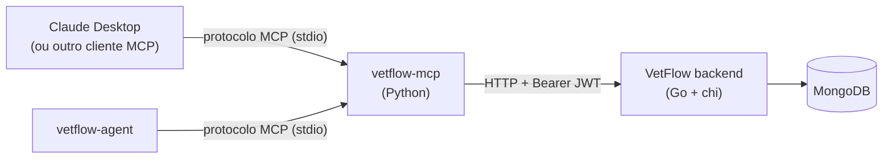

# vetflow-mcp

[](https://github.com/IannCarvalho/vetflow-mcp/actions/workflows/ci.yml)
[](https://codecov.io/gh/IannCarvalho/vetflow-mcp)

Servidor **MCP (Model Context Protocol)** que expõe o backend do
[VetFlow](https://github.com/IannCarvalho/vetflow-backend) — um SaaS de gestão veterinária — como ferramentas
que qualquer LLM compatível pode chamar em linguagem natural: *"quantas
consultas tenho hoje?"*, *"as vacinas do Rex estão em dia?"*, *"me dá o resumo
da clínica"*.

**Consumidores:** além de clientes MCP de desktop (Claude Desktop etc.), este
servidor é consumido pelo [`vetflow-agent`](https://github.com/IannCarvalho/vetflow-agent), que o sobe como
subprocesso stdio e expõe o chat no frontend do VetFlow. É o `vetflow-mcp` que
dá ao agente as **ferramentas** para ler dados reais — o LLM sozinho não conhece
a clínica.

## Arquitetura — "por fora"

O MCP é um processo **separado** do backend. Ele conversa com o VetFlow pela
mesma API HTTP que o frontend usa — não acessa o banco direto, não é compilado
dentro do binário Go. Isso mantém o produto intocado e torna o MCP um projeto
autocontido.



Autenticação: o MCP faz `POST /auth/login` uma vez, guarda o JWT e o injeta como
`Authorization: Bearer <token>` em cada chamada. O backend escopa todos os dados
ao vet dono do token — o MCP não gerencia multi-tenancy.

## Por que MCP (e não uma API direta)

Um agente poderia chamar o backend REST diretamente. O ganho de expor as
ferramentas via **MCP** — um padrão aberto (Model Context Protocol) — é a
**reutilização**: as mesmas ferramentas, escritas uma única vez aqui, funcionam
em **qualquer cliente MCP**, sem reescrever nada.

- **Claude Desktop** — aponte este servidor (ver abaixo) e o Claude já consulta a
  clínica, sem precisar do `vetflow-agent`.
- **vetflow-agent** — o agente web do VetFlow sobe este MCP como subprocesso e
  expõe o chat no frontend.
- **Qualquer outro cliente MCP** — Cursor, IDEs, outros agentes: todos falam o
  mesmo protocolo.

Em outras palavras: o MCP é uma **fronteira reutilizável**. A lógica de "como
traduzir uma intenção em linguagem natural numa chamada autenticada ao backend"
mora num só lugar e serve a todos os consumidores — em vez de cada agente
reimplementar esse acoplamento. As descrições das tools (docstrings PT-BR) são o
que cada LLM lê para decidir *quando* e *como* usá-las.

### Por que um repositório separado (e não dentro do `vetflow-agent`)

É tentador fundir os dois — ambos são Python e o agente é o principal
consumidor. Mas o MCP é o **servidor** e o agente é apenas **um cliente** entre
vários (Claude Desktop e outros clientes MCP usam este servidor **sem o agente
existir**). Dissolver o MCP dentro do agente mataria exatamente a reutilização
que justifica usar MCP: cada cliente teria que reimplementar o acoplamento com o
backend. Servidor e cliente são papéis distintos e ficam em repositórios
distintos, com CI e versionamento próprios.

O agente **consome** este servidor sem fundir código: ele o inclui como git
**submodule** (`vendor/vetflow-mcp`), o que mantém o deploy do agente autocontido
sem transformar o MCP num detalhe interno dele. A dor de ter dois *processos* (o
agente subindo o MCP como subprocesso, custo de RAM) é resolvida em produção
consumindo o MCP **in-process** no agente — isso elimina o segundo processo
mantendo os dois repositórios separados e o modo stdio intacto para o Claude
Desktop. O isolamento por-usuário no modo in-process é preservado por
`contextvars` (`use_request_client`): cada request carrega seu próprio client e
token, sem o furo do `_client` singleton global.

## Tools expostas

Fase 1 — **só-leitura** (10 tools, todas em `server.py`):

| Tool | Endpoint | Pergunta que responde |
|---|---|---|
| `buscar_cliente(nome)` | `GET /clients` (filtra no MCP) | "qual o telefone do dono do Rex?" |
| `listar_pets_do_cliente(cliente_id)` | `GET /pets?owner_id=` | "quantos pets a Ana tem?" |
| `buscar_pet(nome)` | `GET /pets` (filtra no MCP) | "acha o pet chamado Rex" |
| `ficha_do_pet(pet_id)` | `GET /pets/{id}` | espécie, raça, idade, peso |
| `historico_consultas(pet_id)` | `GET /consultations?pet_id=` | "última consulta do Rex?" |
| `historico_vacinas(pet_id)` | `GET /vaccines?pet_id=` | "vacinas do Rex" |
| `vacinas_a_vencer(dias=30)` | `GET /vaccines` (filtra janela no MCP) | alerta proativo |
| `agenda_do_dia(data=hoje)` | `GET /appointments?start=&end=` | "o que tenho hoje?" |
| `faturas_pendentes()` | `GET /invoices` (filtra status no MCP) | financeiro em aberto |
| `metricas_dashboard()` | `GET /dashboard/stats` | "resumo da clínica" |

Só a superfície de leitura fica exposta por padrão — é o que torna seguro ligar
este MCP a qualquer cliente. Escrita existe, mas é opt-in (abaixo).

### Fase 2 — tools de escrita (opt-in)

Desligadas por padrão. Defina `VETFLOW_ENABLE_WRITES=true` para registrá-las.
Cobrem apenas CREATE/UPDATE — **DELETE não é exposto** (destrutivo e
irreversível, deixado de fora de propósito) e não há escrita financeira
(faturas são só leitura):

| Tool | Endpoint |
|---|---|
| `criar_cliente(...)` / `atualizar_cliente(...)` | `POST`/`PUT /clients` |
| `criar_pet(...)` / `atualizar_pet(...)` | `POST`/`PUT /pets` |
| `agendar_compromisso(...)` | `POST /appointments` |
| `mudar_status_compromisso(...)` | `PUT /appointments/{id}` |
| `registrar_consulta(...)` | `POST /consultations` |
| `registrar_vacina(...)` | `POST /vaccines` |

O escopo ao vet autenticado e os campos `vet_id`/`created_at` são setados pelo
backend a partir do token — as tools enviam só os campos de negócio.

## Setup

```bash
# requer Python >= 3.10
python -m venv .venv
# Windows PowerShell:
.\.venv\Scripts\Activate.ps1
# Linux/macOS:  source .venv/bin/activate

pip install -e ".[dev]"

cp .env.example .env   # preencha VETFLOW_BASE_URL / EMAIL / PASSWORD

pytest                 # testes (backend mockado, não precisa do VetFlow no ar)
python -m vetflow_mcp.server   # sobe o servidor via stdio (ou: vetflow-mcp)
```

### Variáveis de ambiente

| Variável | Obrigatória | Papel |
|---|---|---|
| `VETFLOW_BASE_URL` | sim | URL raiz da API Go, ex. `http://localhost:8080`. |
| `VETFLOW_TOKEN` | uma das duas formas de auth | JWT pré-fornecido (**pass-through**): o MCP usa o token como está, sem login. Se ele expirar, a tool devolve "Sessão expirada" — não há como renová-lo aqui. |
| `VETFLOW_EMAIL` / `VETFLOW_PASSWORD` | uma das duas formas de auth | Modo **login**: `POST /auth/login` no primeiro uso, com re-login automático em 401. É o modo do Claude Desktop. |
| `VETFLOW_TIMEOUT_S` | não (default `15`) | Timeout por requisição HTTP, em segundos. |
| `VETFLOW_ENABLE_WRITES` | não (default `false`) | Registra as tools de escrita (`true`/`1`/`yes`/`on`). |

Com `VETFLOW_TOKEN` definido, email/senha são ignorados. Em desenvolvimento, um
`.env` na raiz é carregado automaticamente (`config.py`); variáveis já presentes
no ambiente têm precedência sobre ele.

### Nota: leitura de env e ordem de import

O MCP lê suas variáveis (`VETFLOW_*`) em `config.py` e fala com o backend via
**`httpx`** — ele **não importa o `litellm`** (o LLM mora no
[`vetflow-agent`](https://github.com/IannCarvalho/vetflow-agent), não aqui). Logo, a regra de ordenar
`load_dotenv()` **antes** de `import litellm` — porque o LiteLLM lê o ambiente no
momento do `import` — é uma exigência **do agent**, documentada no README dele,
e **não se aplica a este servidor**. Registrada aqui só para quem navega os dois
repositórios não procurar essa ordenação no lugar errado: no `vetflow-mcp` não há
import que leia env no load, então não há ordem a preservar.

## Ligar no Claude Desktop

No `claude_desktop_config.json` (aponte para o python do venv):

```json
{
  "mcpServers": {
    "vetflow": {
      "command": "C:/caminho/para/vetflow-mcp/.venv/Scripts/python.exe",
      "args": ["-m", "vetflow_mcp.server"],
      "env": {
        "VETFLOW_BASE_URL": "http://localhost:8080",
        "VETFLOW_EMAIL": "vet@exemplo.com",
        "VETFLOW_PASSWORD": "..."
      }
    }
  }
}
```

No Linux/macOS o `command` é `/caminho/para/vetflow-mcp/.venv/bin/python`.

## Uso in-process (como o `vetflow-agent` consome)

Além do stdio, o pacote pode ser chamado **no mesmo processo** — é assim que o
agente roda em produção, sem subir um segundo interpretador Python:

```python
from vetflow_mcp import server

async with server.use_request_client(token=jwt_do_usuario):
    tools = await server.mcp.list_tools()
    resultado = await server.mcp.call_tool("buscar_cliente", {"nome": "ana"})
```

- `use_request_client(token=...)` escopa um `VetFlowClient` à request atual via
  `contextvars`: duas requests concorrentes no mesmo processo não enxergam o
  token uma da outra. Sem `token`, cai no `Settings.from_env()` (email/senha).
- No caminho in-process, `MCPServer.call_tool` **levanta** `ToolError` em caso
  de falha (no stdio, o cliente recebe `isError=true`); a mensagem da exceção é
  o que deve chegar ao modelo.
- As tools de escrita só são registradas por `main()` (entry point do stdio).
  Quem importa o `server` direto recebe **só as de leitura**, mesmo com
  `VETFLOW_ENABLE_WRITES=true`. Para tê-las in-process, registre-as uma vez como
  o `main()` faz: `register_write_tools(server.mcp, server._get_client)`.

## Estrutura

```
vetflow-mcp/
├── pyproject.toml
├── .env.example
├── .github/workflows/ci.yml   # ruff + pytest (com cobertura) na matriz de Python
├── src/vetflow_mcp/
│   ├── config.py       # lê VETFLOW_* do ambiente
│   ├── client.py       # HTTP autenticado: login, cache de token, refresh em 401; erros legíveis
│   ├── server.py       # MCPServer (mcp 2.x) + as 10 tools de leitura; client por-request via contextvars
│   └── write_tools.py  # tools de escrita opt-in (VETFLOW_ENABLE_WRITES)
├── scripts/
│   ├── smoke_e2e.py        # verificação manual das tools de leitura contra um backend vivo
│   └── smoke_write_e2e.py  # idem para escrita (CRIA dados de verdade no backend)
└── tests/
    ├── test_client.py
    ├── test_tools.py
    └── test_write_tools.py
```

## Desenvolvimento

Os mesmos comandos que o CI roda:

```bash
ruff check .
pytest -q --cov=vetflow_mcp --cov-report=term-missing
```

Os testes mockam o backend com `respx` — não precisam de rede nem do VetFlow no
ar. Para conferir contra um backend real (lê o `.env`):

```bash
python scripts/smoke_e2e.py        # só leitura
python scripts/smoke_write_e2e.py  # escrita: cria cliente, pet e vacina de teste
```
